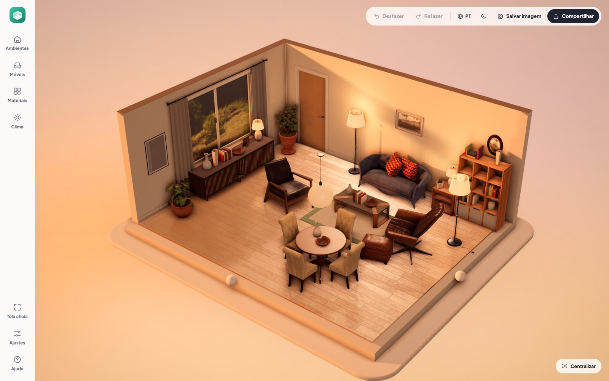
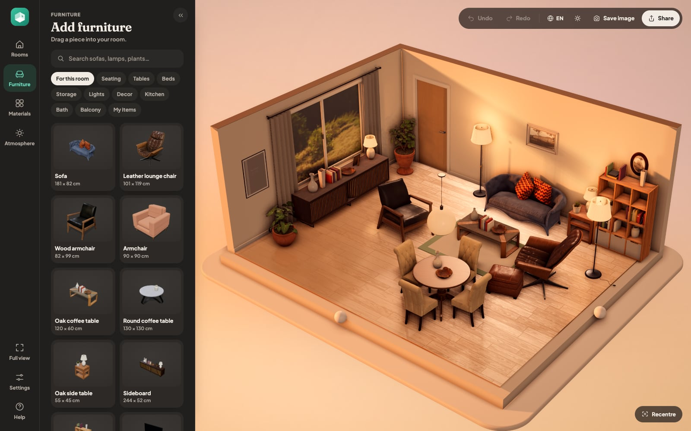
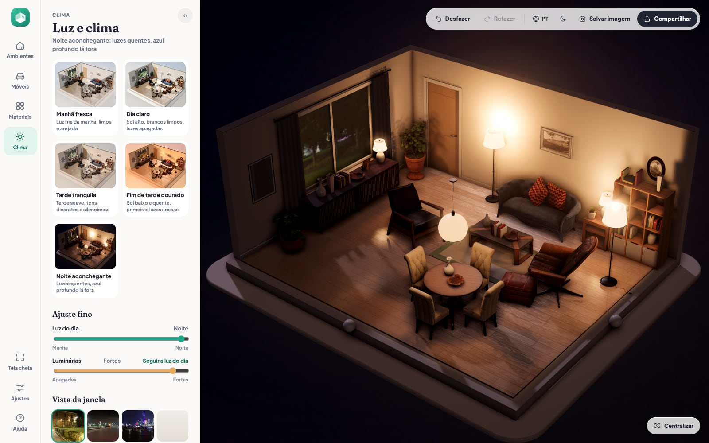
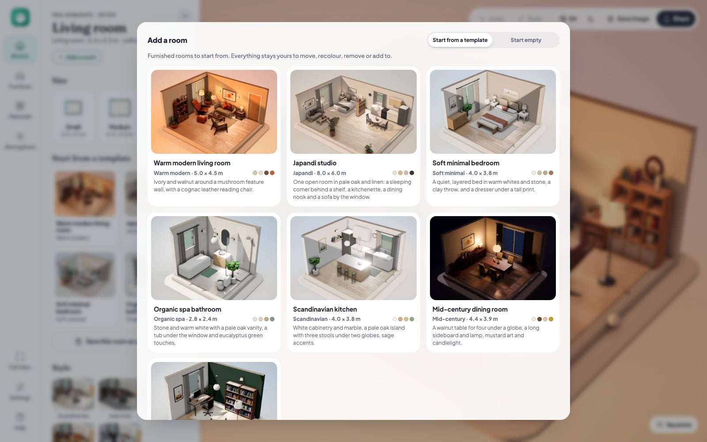
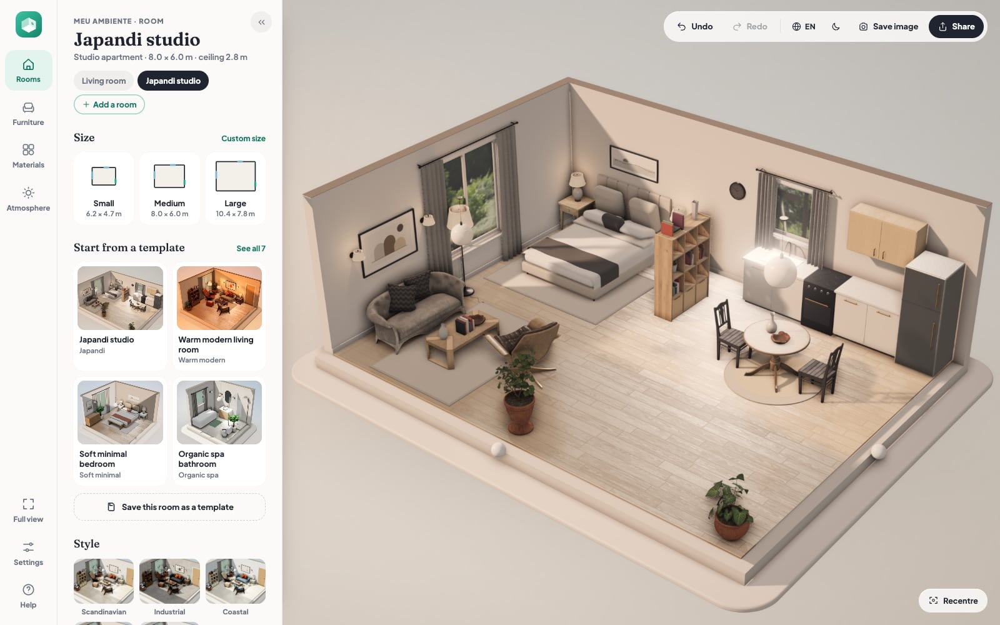

<h1 align="center">Meu Ambiente</h1>

<p align="center">
  <b>Plan and furnish rooms in 3D, right in your browser.</b><br>
  <b>Planeje e mobílie seus ambientes em 3D, direto no navegador.</b>
</p>

<p align="center">
  <a href="https://meu-ambiente.vercel.app/"><b>Open the live app → meu-ambiente.vercel.app</b></a>
</p>



**English.** Meu Ambiente is a 3D room planner that runs entirely in the browser,
with nothing to install and no account. Start from a room an interior designer
might have laid out, or from an empty one; drag in furniture, choose floors and
wall finishes, and watch the light move from a fresh morning to a cosy night,
with a real view through the windows.

**Português.** O Meu Ambiente é um planejador de ambientes em 3D que funciona
inteiro no navegador, sem instalar nada e sem cadastro. Comece por um ambiente
montado como faria um designer de interiores, ou do zero; arraste os móveis,
escolha pisos e acabamentos de parede e veja a luz mudar da manhã fresca à
noite aconchegante, com uma vista de verdade pelas janelas.

| Dark mode, furniture | A night atmosphere |
|---|---|
|  |  |

| Room templates | A template: the Japandi studio |
|---|---|
|  |  |

## Features

- **Seven designed rooms to start from**: living room, bedroom, bathroom,
  kitchen, dining room, home office and studio, each with its own style and
  palette. Save any room as your own template.
- **Real 3D furniture and materials**: CC0 models and photo textures, named
  finishes like light oak or white marble, and your own colours.
- **Light that feels real**: soft sun and lamp shadows, reflections on polished
  floors, and five atmospheres from a fresh morning to a cosy night, plus a
  daylight slider and lamp control. The image keeps refining while you look.
- **Window views from real photos**: a garden, the sea or a city skyline, at
  day, sunset or night, with gentle depth as you move around.
- **Your own furniture from a photo**: the background is cut away by an AI
  model that runs in your browser. Nothing is uploaded.
- **Made to be easy**: a calm side panel with pictures for every choice, hover
  descriptions, a short tour, undo and redo, light and dark mode, and a full
  view that hides everything but the room.
- **Two languages**: Brazilian Portuguese and English, switchable at any time.
- **Yours to keep**: rooms save automatically in your browser; share a room
  with a link or save it as an image.

## Run it locally

No build step is needed to develop; the browser loads the ES modules directly.

```sh
npm start          # http://127.0.0.1:8765/
npm test           # unit tests (Node 20+)
npm run build      # production build in dist/
npm run preview    # build, then serve dist/ at http://127.0.0.1:8765/
```

`npm install` is only needed for the dev tools (asset pipelines, browser
checks, screenshots). How it all works is in [docs/DEVELOPMENT.md](docs/DEVELOPMENT.md).

The site is static. On Vercel, `vercel.json` sets everything: it installs
nothing, runs `npm run build` and publishes `dist/`.

## Credits

3D models, textures and window panoramas come from [Poly Haven](https://polyhaven.com)
(CC0). The AI models (BiRefNet lite, U²-Net-p, CLIP), libraries (three.js,
Transformers.js, ONNX Runtime Web) and fonts (Plus Jakarta Sans, Fraunces) are
under MIT, Apache 2.0 or SIL OFL licences. The full list, with authors, is in
[ASSETS.md](ASSETS.md) and in the app under Settings › About and credits.

## Licence

All rights reserved. The source is public to read, but it is not licensed for
reuse. The third-party assets listed above keep their own licences.
